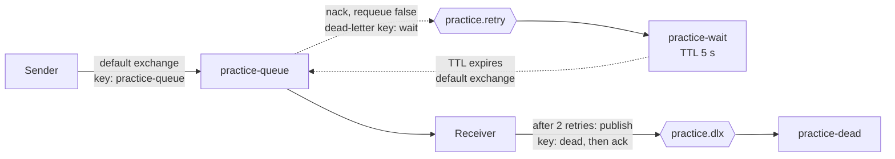

# RabbitMQ Practice Project

A hands-on practice project for learning message-based systems with RabbitMQ and .NET 10. It is not production code, and it is not a claim of production message-bus experience. The goal was to understand the moving parts (acknowledgements, durability, retries, dead-lettering) by building them and watching them fail.

Everything runs locally: RabbitMQ in Docker Compose, plus two .NET console apps that use the official `RabbitMQ.Client` library directly (no MassTransit or other framework), so the concepts stay visible.

## What it does

A **Sender** publishes a text message to a durable queue. A **Receiver** consumes it with manual acknowledgements and a prefetch of 1. "Processing" is simulated: it takes one second, and any message containing the word `poison` (case-insensitive) is treated as a failure.

A failed message is not retried immediately. It goes to a wait queue, sits there for 5 seconds, and returns to the work queue. After 2 retries it is moved to a dead-letter queue so it can be inspected.

## Architecture



| Name | Kind | Settings | Role |
|---|---|---|---|
| `practice-queue` | Queue, classic, durable | Dead-letters to `practice.retry` with key `wait` | Work queue |
| `practice.retry` | Exchange, direct, durable | Binding `wait` to `practice-wait` | Receives rejected messages |
| `practice-wait` | Queue, classic, durable | TTL 5000 ms, dead-letters to the default exchange with key `practice-queue` | Delay before a retry |
| `practice.dlx` | Exchange, direct, durable | Binding `dead` to `practice-dead` | Entry point to the parking lot |
| `practice-dead` | Queue, classic, durable | No dead-letter arguments | Holds messages that exhausted their retries |

The Receiver declares this whole topology on startup. The Sender declares only the work queue, with identical arguments.

### Message flow

1. The Sender publishes a persistent message to the default exchange, using the queue name as the routing key.
2. The Receiver gets it (prefetch 1), waits one second to simulate work, and decides the outcome.
3. **Success:** acknowledge.
4. **Failure with retries left:** reject without requeue. The work queue's dead-letter settings send the message to `practice.retry`, then to `practice-wait`. After 5 seconds it expires back into the work queue. Each trip adds an `x-death` entry whose `count` increases.
5. **Failure with the retry limit reached:** the Receiver publishes the message (with its original headers, marked persistent) to `practice.dlx` with key `dead`, then acknowledges the original.

The retry limit is `maxRetries = 2`, and the message is parked when the death count reaches it. A permanently failing message is therefore delivered 3 times in total: the first attempt plus 2 retries. One cycle takes roughly 6 seconds (1 second of simulated work plus the 5 second TTL).

## Prerequisites

- Docker Desktop
- .NET 10 SDK

Versions used while building this: RabbitMQ 4.3.6 (the floating `rabbitmq:4-management` tag resolved to this), `RabbitMQ.Client` 7.2.2, xunit.v3 4.0.1.

## How to run

```bash
docker compose up -d
```

Starts RabbitMQ with the management UI at http://localhost:15672 (user `admin`, password `password`). These are throwaway local credentials. Ports are bound to `127.0.0.1` only, and the container is capped at 2 CPUs and 2 GB of memory.

In one terminal, start the Receiver. It declares all exchanges and queues:

```bash
dotnet run --project src/Receiver
```

In another terminal, send messages. The text comes from the command line, and defaults to `ticket A` when omitted:

```bash
dotnet run --project src/Sender -- ticket A
dotnet run --project src/Sender -- poison B
```

`ticket A` is processed and acknowledged. `poison B` fails, retries twice, and ends up in `practice-dead`, which you can confirm in the management UI.

Stop everything and wipe all broker state, including the data volume:

```bash
docker compose down -v
```

Plain `docker compose down` keeps the volume, so durable queues and persistent messages survive.

### Troubleshooting

- On one Windows machine, `docker compose up` failed with an error about `docker-credential-desktop` not being found. Running the same command from the Docker Desktop terminal worked. I did not diagnose the cause.

## What is tested

### Automated (17 xUnit v3 test cases)

`dotnet test` from the repo root runs them. They cover the pure decision logic, which lives in `RetryPolicy`:

- `Decide`: success always acknowledges, failures retry below the limit and park at or above it, including the boundary and a limit of 0.
- `GetDeathCount`: returns 0 for null headers or headers without `x-death`; reads the first entry's count (integer and long); throws `InvalidOperationException` for an empty array, a wrong-typed `x-death`, a non-dictionary entry, a missing `count`, a non-numeric count, and a null count.

I also checked that the tests can fail by temporarily introducing three bugs (`>=` changed to `>`, a wrong-typed header returning 0, and a null-unsafe count parse). Each was caught by exactly the tests expected.

### Verified by hand against a real broker

Nothing automated talks to RabbitMQ. These behaviors were observed manually:

| Behavior | How it was checked |
|---|---|
| A message is removed only when acknowledged | Fetched messages in the management UI with different ack modes; stopped a consumer mid-message and watched the broker redeliver it |
| Durable queue plus persistent message survives a broker restart; a non-persistent message does not | `docker compose restart` with each kind of message |
| Data survives `down` but not `down -v` | Created a durable queue, then compared the broker's startup logs after each command |
| Prefetch of 1 stops one worker holding a batch of messages | Compared queue counts with and without it; ran two Receivers against one queue |
| Retry with delay, retry cap, and dead-lettering | Ran `poison` messages end to end |
| The full topology comes up from code alone | Wiped the broker with `docker compose down -v`, started the Receiver, and repeated the poison test |
| Topic exchange routing | **UI exercise only.** Built an exchange with three wildcard bindings in the management UI and published to it by hand. It is not part of this repo's code. |

## Design decisions

- **Default exchange for the Sender.** Publishing straight to the queue name keeps the first version simple. A named exchange would be the next step for several independent consumers.
- **Acknowledge after the work, not before.** A crash before the ack returns the message to the queue; acking first would lose it.
- **Prefetch of 1.** Safe and easy to reason about, but not fast. A real system would use a higher value.
- **Classic queues.** Chosen to match the queue already in the broker while debugging. Quorum queues (used by the current official tutorials) were not evaluated.
- **Decision logic is separate from I/O.** `RetryPolicy` is a pair of pure functions, so it can be unit tested without a broker.
- **A malformed `x-death` header throws instead of returning 0.** Returning 0 would make a message with an unexpected header retry forever and never reach the cap.
- **Topology declared in code on both sides.** The queue arguments are duplicated in the Sender and Receiver. A mismatch causes a `PRECONDITION_FAILED` error.

## Known limitations

- **The `x-death` ordering is assumed.** The code reads the first entry. On RabbitMQ 4.3.6, a retried message carries two entries: the wait queue's `expired` entry first, then the work queue's `rejected` entry, each with the same count. This was confirmed by decoding the header in the debugger. The code would need revisiting if the topology changed.
- **Publish-then-acknowledge is not atomic.** If the Receiver crashes between publishing to the dead-letter exchange and acknowledging, the message is redelivered and parked twice. Publisher confirms would narrow the gap and were not used.
- **Exception behavior is untested.** If the handler throws (for example on a malformed header), what the client does with the channel and the message was not tested.
- **The retry-limit boundary was a deliberate choice.** `maxRetries = 2` with `>=` means 2 retries. Using `>` would allow 3.
- **The image tag floats.** `rabbitmq:4-management` may resolve to a different version later. Pin an exact version for reproducible runs.
- **Credentials are hard-coded** throwaway values, acceptable only because the broker listens on localhost.

## Gotchas I hit

1. **`PRECONDITION_FAILED` on `x-queue-type`.** The official tutorial declares a quorum queue, but the queue I had created in the UI was classic. A queue's arguments are part of its identity, so a mismatching declaration is refused instead of modifying the queue. Fix: match the existing queue, or delete and recreate it.
2. **A silently dropped message in the retry loop.** The wait queue's dead-letter exchange had been entered as two literal quote characters instead of an empty string. The management UI showed the same text for both, so the queue looked correct. The messages vanished when the TTL expired, because RabbitMQ drops dead-lettered messages without an error when the target exchange does not exist. I found it by reading the queue's raw arguments from the management HTTP API.
3. **A routing key mismatch.** The work queue dead-lettered with key `wait`, but the retry exchange was bound with `retry`. Caught while reviewing the topology, before any message was lost.
4. **Topology that only worked on my broker.** The dead-letter exchange and queue existed only because I had created them by hand. Declaring them in code and rerunning from a wiped broker fixed it.

## Not included

- An ASP.NET Core API or a Worker Service host (both apps are plain console programs)
- Publisher confirms
- An idempotent handler or duplicate-message detection
- Authentication on any API
- A Dockerfile for the apps
- MassTransit or any other messaging framework
- Integration tests against a real broker
- Quorum queues, clustering, or multi-node behavior
- Topic exchange routing in code (explored only by hand in the management UI)

## Repository layout

```text
compose.yaml              RabbitMQ with the management UI
global.json               Selects the Microsoft.Testing.Platform test runner
src/Sender/               Publishes a message from the command line
src/Receiver/             Consumer, retry topology, and RetryPolicy
tests/Receiver.Tests/     xUnit v3 tests for RetryPolicy
```
