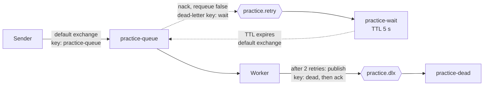
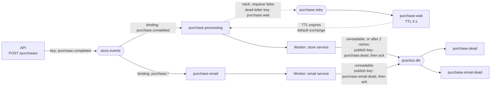

# RabbitMQ Practice Project

A hands-on practice project for learning message-based systems with RabbitMQ and .NET 10. It is not production code, and it is not a claim of production message-bus experience. The goal was to understand the moving parts (acknowledgements, durability, retries, dead-lettering, routing) by building them and watching them fail.

Everything runs locally: RabbitMQ in Docker Compose, plus a console Sender, an ASP.NET Core API, a Worker Service with three consumers, and a small shared library. They use the official `RabbitMQ.Client` library directly (no MassTransit or other framework), so the concepts stay visible.

## What it does

The project has two flows that share one broker.

**The practice flow.** A **Sender** publishes a text message to a durable queue. The Worker's practice service consumes it with manual acknowledgements and a prefetch of 1. "Processing" is simulated: it takes one second, and any message containing the word `poison` (case-insensitive) is treated as a failure.

A failed message is not retried immediately. It goes to a wait queue, sits there for 5 seconds, and returns to the work queue. After 2 retries it is moved to a dead-letter queue so it can be inspected.

**The store flow.** An **API** accepts a purchase (`POST /purchases` with a product name and a quantity), validates it, and publishes a `PurchaseCompleted` event to a topic exchange. The Worker's store service reads the events from its own queue. The API publishes to an exchange, not to a queue, so it does not know who consumes the events. The consumer does no real work: it reads the event, prints its ID, and acknowledges it. Processing is simulated, and a product name containing `poison` counts as a transient failure. As in the practice flow, a failed event goes to a wait queue, returns after 5 seconds, and is parked in its own dead-letter queue after 2 retries.

A second consumer, the Worker's email service, reads the same events from its own queue. It is a stub: it prints the event ID and acknowledges it, and it never retries. Each consumer gets its own copy of every event.

## Architecture

### The practice flow



| Name | Kind | Settings | Role |
|---|---|---|---|
| `practice-queue` | Queue, classic, durable | Dead-letters to `practice.retry` with key `wait` | Work queue |
| `practice.retry` | Exchange, direct, durable | Binding `wait` to `practice-wait` | Receives rejected messages |
| `practice-wait` | Queue, classic, durable | TTL 5000 ms, dead-letters to the default exchange with key `practice-queue` | Delay before a retry |
| `practice.dlx` | Exchange, direct, durable | Binding `dead` to `practice-dead`, binding `purchase.dead` to `purchase-dead`, and binding `purchase.email.dead` to `purchase-email-dead` | Entry point to the parking lots of all three consumers |
| `practice-dead` | Queue, classic, durable | No dead-letter arguments | Holds messages that exhausted their retries |

The Worker's practice service declares this whole topology on startup. The Sender declares only the work queue. Both call the same declaration code in the Messaging project, so the queue arguments are written once.

### The store flow



| Name | Kind | Settings | Role |
|---|---|---|---|
| `store.events` | Exchange, topic, durable | Declared by the API and by each consumer | Entry point for purchase events |
| `purchase-processing` | Queue, classic, durable | Bound to `store.events` with key `purchase.completed`. Dead-letters to `purchase.retry` with key `purchase.wait`. Declared by the consumer. | The consumer's queue, named for its job |
| `purchase.retry` | Exchange, direct, durable | Binding `purchase.wait` to `purchase-wait` | Receives rejected purchase messages |
| `purchase-wait` | Queue, classic, durable | TTL 5000 ms, dead-letters to the default exchange with key `purchase-processing` | Delay before a retry |
| `purchase-dead` | Queue, classic, durable | Bound to `practice.dlx` with key `purchase.dead` | Holds purchase messages that could not be read, or that failed after 2 retries |
| `purchase-email` | Queue, classic, durable | Bound to `store.events` with key `purchase.*`. Declared by the email service. | The email service's queue, named for its job |
| `purchase-email-dead` | Queue, classic, durable | Bound to `practice.dlx` with key `purchase.email.dead` | Holds events the email service could not read |

The three dead-letter queues share one exchange but use different routing keys (`dead`, `purchase.dead`, and `purchase.email.dead`), so each consumer's parked messages land in its own queue.

The API declares only the exchange. Each consumer declares its own queue and binding. The result is that an event published before a consumer's queue has ever existed is never delivered to that consumer (see Known limitations).

### Message flow: the practice flow

1. The Sender publishes a persistent message to the default exchange, using the queue name as the routing key.
2. The Worker gets it (prefetch 1), waits one second to simulate work, and decides the outcome.
3. **Success:** acknowledge.
4. **Failure with retries left:** reject without requeue. The work queue's dead-letter settings send the message to `practice.retry`, then to `practice-wait`. After 5 seconds it expires back into the work queue. Each trip adds an `x-death` entry whose `count` increases.
5. **Failure with the retry limit reached:** the Worker publishes the message (with its original headers, marked persistent) to `practice.dlx` with key `dead`, then acknowledges the original.
6. **Shutdown (Ctrl+C):** the Worker cancels its consumer so no new messages arrive, then waits up to 15 seconds for a message already in progress to finish and be acknowledged, then closes the channel and the connection. A message that reaches the handler after shutdown began is left unacknowledged, and the broker redelivers it once the channel closes. That last path was never triggered in testing (see Known limitations). All three Worker services use this sequence.

The retry limit is `maxRetries = 2`, and the message is parked when the death count reaches it. A permanently failing message is therefore delivered 3 times in total: the first attempt plus 2 retries. One cycle takes roughly 6 seconds (1 second of simulated work plus the 5 second TTL).

### Message flow: the store flow

1. A client sends `POST /purchases` with a quantity and a product name. The API validates the request: the quantity must be from 1 to 100, and the product name must be present and at most 100 characters. A request that fails validation gets a 400, and nothing is published.
2. The API builds a `PurchaseCompleted` event. It sets the message ID (a new GUID) and the timestamp (UTC) itself, so a client cannot choose them. It serializes the event to JSON and publishes it, persistent and with a JSON content type, to `store.events` with key `purchase.completed`. The response is 202 Accepted, with the event in the body.
3. The store service (prefetch 1) deserializes the body, prints the event ID, waits one second to simulate work, and asks `RetryPolicy` for the outcome. An event whose product name contains `poison` (case-insensitive) counts as a failure.
4. **Success:** acknowledge.
5. **Failure with retries left:** reject without requeue. The queue's dead-letter settings send the event to `purchase.retry`, then to `purchase-wait`. After 5 seconds it expires back into `purchase-processing`.
6. **Failure with the retry limit reached:** the service publishes the original body (with its headers, marked persistent) to `practice.dlx` with key `purchase.dead`, then acknowledges the original. That is 3 deliveries in total, as in the practice flow.
7. **Unreadable message:** if reading the message throws (invalid JSON, a missing required field, or a malformed `x-death` header), it is parked the same way at once, with no retry, because retrying cannot fix it.
8. **The email service** reads its own copy of the same event from `purchase-email`, prints the event ID, waits one second to simulate work, and acknowledges it. It never retries. If it cannot read the body, it publishes the original to `practice.dlx` with key `purchase.email.dead` and then acknowledges the original.
9. **The two consumers are independent.** A product name containing `poison` is a failure for the store service and an ordinary success for the email service.

## Prerequisites

- Docker Desktop
- .NET 10 SDK

Versions used while building this: RabbitMQ 4.3.6 (the floating `rabbitmq:4-management` tag resolved to this), `RabbitMQ.Client` 7.2.2, `Microsoft.Extensions.Hosting` 10.0.13, `Microsoft.AspNetCore.OpenApi` 10.0.13, xunit.v3 4.0.1.

## How to run

```bash
docker compose up -d
```

Starts RabbitMQ with the management UI at http://localhost:15672 (user `admin`, password `password`). These are throwaway local credentials. Ports are bound to `127.0.0.1` only, and the container is capped at 2 CPUs and 2 GB of memory.

Next, give the apps the same credentials. The broker host (`localhost`) is in each app's `appsettings.json`. The user name and password are .NET user secrets, which are stored outside the repository and are loaded only in the Development environment. All three apps' launch profiles set Development, so `dotnet run` picks them up. All three projects share one user secrets ID, so you set the values once:

```bash
dotnet user-secrets set "RabbitMQ:UserName" "admin" --project src/RabbitMqPractice.Worker
dotnet user-secrets set "RabbitMQ:Password" "password" --project src/RabbitMqPractice.Worker
```

The values must match `RABBITMQ_DEFAULT_USER` and `RABBITMQ_DEFAULT_PASS` in `compose.yaml`. No `user-secrets init` is needed, because the secrets ID is already in the project files. If a value is missing, the connection code throws an `InvalidOperationException` such as `UserName is not configured`.

In one terminal, start the Worker. Its three services declare the exchanges and queues of both flows:

```bash
dotnet run --project src/RabbitMqPractice.Worker
```

Press Ctrl+C to stop it. Step 6 of the practice message flow describes what happens to a message in progress.

### The practice flow

In another terminal, send messages. The text comes from the command line, and defaults to `ticket A` when omitted:

```bash
dotnet run --project src/RabbitMqPractice.Sender -- ticket A
dotnet run --project src/RabbitMqPractice.Sender -- poison B
```

`ticket A` is processed and acknowledged. `poison B` fails, retries twice, and ends up in `practice-dead`, which you can confirm in the management UI.

### The store flow

Start the Worker first, at least once. The API declares only the exchange, and the store service declares its own queue, so an event published before that queue has ever existed is dropped by the broker.

Then start the API:

```bash
dotnet run --project src/RabbitMqPractice.Api
```

This uses the `http` launch profile, so the API listens on http://localhost:5025. The Visual Studio debugger defaults to the `https` profile on port 7261. With the `http` profile, a warning that the HTTPS port could not be determined appeared in every run, and it was harmless.

Send requests with the `.http` file in `src/RabbitMqPractice.Api`, which Visual Studio can run. It has a valid purchase and several invalid ones. A valid request returns 202 with the event, and the Worker prints `Received PurchaseCompleted message '<id>'` and `Processing of message '<id>' succeeded.` The email service prints the same ID, tagged `[email]`.

To watch a retry, send a request whose product name contains `poison`, such as `poison widget`. The Worker receives the event three times, then parks it in `purchase-dead`, where the management UI shows its `x-death` header.

To see the wildcard, publish a valid `PurchaseCompleted` body from the management UI to `store.events` with the key `purchase.refunded`. Only the email service receives it.

To see an event without the consumers, create a queue in the management UI, bind it to `store.events` with the key `purchase.completed`, and use Get Messages on it.

### Stopping and resetting

Stop everything and wipe all broker state, including the data volume:

```bash
docker compose down -v
```

Plain `docker compose down` keeps the volume, so durable queues and persistent messages survive.

### Troubleshooting

- On one Windows machine, `docker compose up` failed with an error about `docker-credential-desktop` not being found. Running the same command from the Docker Desktop terminal worked. I did not diagnose the cause.
- `UserName is not configured` (or the same message for another setting) means that setting was not found. The user secrets may not be set, or the app may not be running in the Development environment. For example, `dotnet run --no-launch-profile` skips the launch profile, so the secrets are not loaded.
- A connection that just appeared shows 0 channels in the management UI. The statistics lag by a few seconds, and a refresh showed the channel (observed after starting the Worker).
- The API returns 202 but the Worker never prints the event. The store service's queue probably did not exist yet when the event was published, so the broker dropped it. Start the Worker first.

## What is tested

### Automated (35 xUnit v3 test cases)

`dotnet test` from the repo root runs both test projects.

**`RabbitMqPractice.Worker.Tests` (17 cases)** cover the pure decision logic, which lives in `RetryPolicy`:

- `Decide`: success always acknowledges, failures retry below the limit and park at or above it, including the boundary and a limit of 0.
- `GetDeathCount`: returns 0 for null headers or headers without `x-death`; reads the first entry's count (integer and long); throws `InvalidOperationException` for an empty array, a wrong-typed `x-death`, a non-dictionary entry, a missing `count`, a non-numeric count, and a null count.

I also checked that these tests can fail by temporarily introducing three bugs (`>=` changed to `>`, a wrong-typed header returning 0, and a null-unsafe count parse). Each was caught by exactly the tests expected.

**`RabbitMqPractice.Messaging.Tests` (18 cases)** cover the event serializer:

- A serialized event deserializes to an equal event.
- The JSON uses camelCase names: `messageId`, `timestamp`, `quantity`, and `productName`.
- Valid bodies deserialize: camelCase names, PascalCase names, and a body with an unknown extra property.
- Invalid bodies throw `JsonException`: an empty body, truncated JSON, the `null` literal, an array instead of an object, an empty object, a quantity that is not a number, and a missing quantity.
- Three standalone tests: missing required properties (the message mentions "required"), malformed JSON, and the `null` literal (the message mentions "null").

The valid bodies act as a control. A deserializer that rejected everything would fail them, so the invalid rows cannot pass by accident.

Nothing automated covers the API endpoint, the publisher, either Worker service, or the host.

### Verified by hand against a real broker

Nothing automated talks to RabbitMQ. These behaviors were observed manually. Rows marked (v1.0.0) were checked on the original console version, before the Worker Service host, and were not repeated. Some checks used a temporary longer simulated delay (5, 10, or 30 seconds) so the window was easy to hit.

| Behavior | How it was checked |
|---|---|
| A message is removed only when acknowledged | Fetched messages in the management UI with different ack modes; stopped a consumer mid-message and watched the broker redeliver it (v1.0.0) |
| Durable queue plus persistent message survives a broker restart; a non-persistent message does not | `docker compose restart` with each kind of message (v1.0.0) |
| Data survives `down` but not `down -v` | Created a durable queue, then compared the broker's startup logs after each command (v1.0.0) |
| Prefetch of 1 stops one worker holding a batch of messages | Compared queue counts with and without it; ran two consumers against one queue (v1.0.0) |
| Retry with delay, retry cap, and dead-lettering | Ran `poison` messages end to end |
| The full topology comes up from code alone | Wiped the broker with `docker compose down -v`, started the Worker, and repeated the poison test |
| Starting the Sender first or the Worker first gives the same broker state | Wiped the broker, ran each order, and compared `rabbitmqctl list_queues name durable arguments messages` with a saved baseline. The output was identical both times. |
| A message in progress at Ctrl+C is finished and acknowledged | With a 10 second simulated delay, pressed Ctrl+C mid-message. The message was acknowledged and the queue was empty afterward. |
| No new message is started after Ctrl+C | Queued two messages and pressed Ctrl+C during the first. The second stayed in the queue and was processed on the next start. |
| A handler that outlives the 15 second wait loses its acknowledgement | With a 30 second simulated delay, the Worker warned after about 15 seconds. The acknowledgement failed with `AlreadyClosedException`, which was logged, and the message returned to the queue. Shutdown took about 29 seconds. |
| The Worker loads user secrets through the default host | Ran it with `dotnet run`. It reported the Development environment and connected, with the user name and password coming only from user secrets. |
| A missing setting is reported by name | Ran the Sender with `dotnet run --no-launch-profile`, so no secrets were loaded. It threw `InvalidOperationException: UserName is not configured`. |
| The API validates requests | Sent a valid request (202 with the event), a quantity of 0, an empty name, a null name, and a body with no quantity. Every invalid request returned 400. Validation failures returned a JSON body with the field errors. The missing quantity failed earlier, during binding, and returned a plain-text exception message instead. A body that tried to choose its own message ID got a server-generated one back. |
| A published event reaches a bound queue in the right shape | Bound a scratch queue to `store.events` by hand with key `purchase.completed`, sent a request, and used Get Messages. The message had the right exchange and routing key, delivery mode 2 (persistent), content type `application/json`, and a camelCase JSON body. |
| An event published to an exchange with no bound queue is dropped without an error | Removed the binding and sent a request. The API still returned 202, and the queue's message count did not change. With the binding restored, the next request arrived. |
| An event published before the consumer's queue exists is lost | Wiped the broker, started only the API, sent a request, then started the Worker. The Worker received nothing. |
| `store.events` is a durable topic exchange | `rabbitmqctl list_exchanges name type durable` |
| The store service reads events from its own queue | Wiped the broker, then ran the API first and the Worker second, and the Worker first and the API second. Each time the Worker printed the event ID and acknowledged it, and `purchase-processing` was empty afterward. |
| Unreadable purchase messages are parked in their own queue | Published `not json` and `{"quantity":1}` to `store.events` from the management UI. Each was logged with the serializer's exception and parked. `purchase-dead` went from 0 to 2, and `practice-dead` stayed at 1. |
| A transient failure on the store queue is retried with a delay, then parked | Sent a request with the product name `poison widget`. The Worker received the event three times, logging "retried 1 time(s)" and "retried 2 time(s)" on the second and third, then parked it. It sat in `purchase-dead` with an `x-death` header. This run used a 5 second simulated delay. |
| A retry wait does not block the consumer | Sent a normal request right after the failing event's first rejection. The Worker processed it before the failing event's second delivery. This run used a 5 second simulated delay. |
| An unreadable body skips the retry loop | Published `not json` from the management UI. It was logged and parked at once, with no retry lines, and the parked message had no `x-death` header. |
| The `x-death` header on the purchase queue has the same shape as on the practice queue | Read in the management UI on the parked message: the wait queue's `expired` entry first, then the work queue's `rejected` entry, both with count 2. The `rejected` entry named `store.events` and the key `purchase.completed`. RabbitMQ also added `x-first-death-*` and `x-last-death-*` headers. The `time` values were five seconds apart, and by the console timing they were the first occurrence, not the latest. That last part is my reading of one run. |
| One event reaches two consumers, each with its own copy | Sent one request with the Worker running: the store service and the email service printed the same message ID and both succeeded. With the Worker stopped, three requests left 3 messages in `purchase-processing` and 3 in `purchase-email`. Starting the Worker drained both, and each service processed the same three IDs in the same order. |
| A wildcard binding routes in code | Published a valid event from the management UI to `store.events` with the key `purchase.refunded`. Only the email service received it, and `purchase-processing` stayed at 0. |
| Each consumer parks unreadable messages in its own dead-letter queue | Published `not json` with the key `purchase.completed`. Each service logged the read failure and parked its copy: `purchase-dead` and `purchase-email-dead` each went up by 1, and `practice-dead` did not change. |
| Consumers fail independently | Sent a request with the product name `poison widget`. The store service retried it twice and then parked it in `purchase-dead`. The email service, which has no failure rule, acknowledged it once, and `purchase-email-dead` did not change. |
| The practice flow is unchanged by the store flow | After the store topology was added, again after the purchase retry topology, and again after the email queues, the `rabbitmqctl list_queues name durable arguments messages` output for the three practice queues was identical to the saved baseline. |
| The API's connection is named and closes cleanly | The `ClientProvidedName` appeared in the broker log and the management UI. Every API shutdown logged a matching `closing AMQP connection` line at info level, with no warning. |
| Each service has its own named connection | The management UI's Connections tab showed four connections named `practice`, `store`, `email`, and `api`, with one channel each. A look right after the Worker started showed 0 channels on the Worker connections, and a refresh a few seconds later showed 1 each, so the UI's statistics lag. |
| Topic exchange routing with several wildcard bindings | **Partly a UI exercise.** Built an exchange with three wildcard bindings in the management UI and published to it by hand. The code binds one queue with an exact key (`purchase.completed`) and one with a wildcard (`purchase.*`), and the rows above check that routing. |

## Design decisions

- **Default exchange for the Sender.** Publishing straight to the queue name keeps the first version simple. The store flow is the named-exchange version, for independent consumers.
- **Acknowledge after the work, not before.** A crash before the ack returns the message to the queue; acking first would lose it.
- **Prefetch of 1.** Safe and easy to reason about, but not fast. A real system would use a higher value.
- **Classic queues.** Chosen to match the queue already in the broker while debugging. Quorum queues (used by the current official tutorials) were not evaluated.
- **Decision logic is separate from I/O.** `RetryPolicy` is a pair of pure functions, so it can be unit tested without a broker. It stays in the Worker project because only the consumer retries.
- **A malformed `x-death` header throws instead of returning 0.** Returning 0 would make a message with an unexpected header retry forever and never reach the cap.
- **Topology is declared once, in a shared project.** `RabbitMqPractice.Messaging` holds the exchange, queue, and routing key names and the declaration code. The apps call it, so each queue's arguments exist in one place (two copies that disagree would fail with `PRECONDITION_FAILED`). The Sender calls only the work-queue declaration, so starting it before the Worker still works.
- **Each Worker service owns its own connection and channel.** The practice service and the store service each open a connection and a channel. They are not registered in dependency injection. Only the small class that builds the connection settings is registered.
- **Shutdown drains the message in progress.** A semaphore is held while the handler runs. On stop, each service cancels its consumer first, then waits (up to 15 seconds) to take the semaphore, then closes the channel and the connection. Each cleanup step is guarded separately with its own time budget, so one failure does not skip the rest. Draining fits because the simulated work takes about one second. For long-running handlers, abandoning the message and accepting a redelivery would be the better trade.
- **A missing setting is an error, not an empty default.** The host name is in `appsettings.json`. The user name and password are user secrets (Development only). The connection code throws if a value is missing, so the error names the setting.
- **The API's publisher owns one connection and one long-lived channel, behind a semaphore.** The official .NET client guide (the version I read covers 7.0) says that concurrent publishing on a shared channel causes incorrect frame interleaving, and that mutual exclusion is the fix. It also recommends long-lived channels. The publish call takes no cancellation token: once a publish starts, it finishes before the semaphore is released.
- **The publisher is created at startup and registered as a singleton through a delegate.** If the broker is unreachable, the API fails to start instead of failing on the first request. Registering through a delegate, and not an instance, makes the container own the publisher, so it is disposed on shutdown. Microsoft's DI guidelines say the container does not dispose instances it did not create. Every shutdown showed a clean connection close in the broker log.
- **The request type is separate from the event.** The client sends a product name and a quantity. The server sets the message ID and the timestamp, so a client cannot choose them. The event's members are `required`, so an event built without them does not compile, and the JSON deserializer rejects a message body that lacks them (checked in the tests).
- **202 Accepted, with the event in the body.** There are no publisher confirms, so the API cannot say the broker has the message. It reports only that the request was accepted.
- **The API declares only the exchange, and the consumer declares its own queue and binding.** The API does not know who consumes the events, which is the point of publishing to an exchange, and a second consumer would need no API change (the email service was added without touching the API). The cost is the cold-start gap described below.
- **Queues are named for the consumer's job.** `purchase-processing` and `purchase-email`, not names based on the event, so each consumer has its own queue bound to the same exchange.
- **Parked purchase messages use a separate routing key.** The store service publishes them to `practice.dlx` with key `purchase.dead` and acknowledges the original, the same pattern as the practice flow. A queue has a single dead-letter exchange setting, and on `purchase-processing` it points at the retry exchange, so parking is done by publishing from the consumer.
- **The store queue has its own retry exchange and wait queue.** `purchase.retry` and `purchase-wait`, not the practice flow's, so the two flows stay independent. Sharing `practice.retry` with a different key would also have worked.
- **One `RetryPolicy` serves both flows.** The decision (acknowledge, retry, or park) is the same pure function, fed a failure flag and the `x-death` count.
- **Unreadable messages never enter the retry loop.** Retrying cannot fix a body that cannot be parsed, so the service parks it at once. Only failures that might clear up on their own are retried.
- **Each consumer has its own queue, and so its own copy of every event.** A queue hands each message to one consumer, so two consumers on one queue would split the events (I saw that with two consumers on the practice queue). Two queues bound to one exchange give each consumer every event.
- **The email service binds with a wildcard, and the store service with an exact key.** `purchase.*` lets the email service see any single-word purchase event, such as `purchase.refunded`, while processing sees only `purchase.completed`. The wildcard matches exactly one word after the dot (observed with `purchase.refunded`; a two-word key was not tried).
- **The email service has its own dead-letter queue and no retry.** The stub cannot fail transiently, and an unreadable body cannot be fixed by retrying, so unreadable events are parked at once. Its queue has no dead-letter arguments, so the service never rejects a message: it acknowledges or parks, and its switch has no retry case, so an unexpected outcome throws.
- **The three Worker services are copies, not a shared base class.** The shutdown sequence is repeated on purpose, so each service stays readable and was verified on its own. Extracting a base class is a possible later cleanup.
- **One serializer for both sides.** `EventSerializer` in the Messaging project holds the JSON options (the web defaults: camelCase names, case-insensitive reading) and the content type, so the publisher and the consumer cannot disagree. A body of `null` is treated as an error like any other unreadable body.

## Known limitations

- **The `x-death` ordering is assumed.** The code reads the first entry. On RabbitMQ 4.3.6, a retried message carries two entries: the wait queue's `expired` entry first, then the work queue's `rejected` entry, each with the same count. This was confirmed by decoding the header in the debugger on the practice queue, and by reading it in the management UI on the purchase queue. The code would need revisiting if the topology changed.
- **Publish-then-acknowledge is not atomic.** If a Worker service crashes between publishing to the dead-letter exchange and acknowledging, the message is redelivered and parked twice. Publisher confirms would narrow the gap and were not used.
- **Exception behavior is only partly tested.** Observed: an acknowledgement on an already-closed channel throws `AlreadyClosedException`, which the handler logs and rethrows. Not tested: what the client does with the message and the channel when a handler throws on an open channel.
- **The retry-limit boundary was a deliberate choice.** `maxRetries = 2` with `>=` means 2 retries. Using `>` would allow 3.
- **The image tag floats.** `rabbitmq:4-management` may resolve to a different version later. Pin an exact version for reproducible runs.
- **Credentials.** The apps read them from user secrets, which is a development-only mechanism, and no other source was tested. The broker's throwaway credentials are still committed in `compose.yaml` and this README, which is acceptable only because the broker listens on localhost.
- **Shutdown time follows the handler, not the time budgets.** In the one run with a 30 second handler, the connection close ran about 9 seconds against its 5 second budget, and the acknowledgement was lost. The message was redelivered. The host's own shutdown timeout was not tested.
- **Three Worker services share one shutdown window.** Each service's cleanup can take up to about 28 seconds in a worst case, and the host's default shutdown timeout is 30 seconds. Whether the services stop one after the other or together was not checked.
- **The late-message guard was never triggered.** After Ctrl+C the consumer is cancelled first, and in testing no message reached the handler afterward. The branch that leaves such a message unacknowledged is unexercised.
- **Duplicate processing is possible.** A lost acknowledgement means a redelivery and a second run of the work; an early shutdown experiment processed the same message twice. There is no idempotent handler yet.
- **Launch location.** The Worker found its `appsettings.json` under `dotnet run` and in the debugger, and the API found its under `dotnet run`. Launching the built executables directly from another folder was not tested.
- **A cold-start gap.** An event published before a consumer's queue has ever existed is not delivered to that consumer, with no error, and the API still returns 202 (observed for the store queue). Once a queue exists, durability protects it.
- **A 202 is not a delivery guarantee.** There are no publisher confirms, and `mandatory` is false, so an unroutable event is dropped silently (observed). The client guide says messages published while the connection is down can be lost.
- **The publish takes no cancellation token.** My reasoning, which I did not test, is that a stalled broker would hold the semaphore while every other request waited behind it.
- **A dead channel stays dead.** The client guide says channel-level exceptions close the channel and closed channels are not recovered. The publisher does not recreate its channel. Not tested.
- **Broker failures while the API runs were not tested.** There is no handling for them, so a publish that fails would fail the request.
- **A narrow race on a Worker channel at shutdown.** The shutdown path cancels the consumer on the same channel that a handler may be using to publish to the dead-letter exchange. The client guide says publishers must not share a channel across threads. The window is small, and I did not observe a problem.
- **The API creates its publisher before the host is built.** My reasoning, which I did not try, is that tests which start the host would need a live broker even with a fake publisher registered, until this is restructured.
- **The two validation failure shapes differ.** A validation failure returns a JSON body. A body missing a required field fails during binding and returned a plain-text exception message in Development. Production behavior was not checked.
- **Serializer edge cases are not covered.** Numbers sent as strings, duplicate property names, and a UTF-8 byte order mark.
- **The purchase retry reuses the practice flow's fixed delay and cap.** 5 seconds and 2 retries, with no backoff. The failure rule is simulated: a product name containing `poison`.
- **Parked messages lose their content type.** The park publish copies only the persistence flag and the headers, so the copy in the dead-letter queue has no content type (seen in the management UI). Cosmetic.
- **Two of the three Worker services log untagged lines,** so their shutdown messages cannot be told apart. The email service tags its lines with `[email]`.
- **The email service is a stub.** It does no real work and has no retry.

## Gotchas I hit

1. **`PRECONDITION_FAILED` on `x-queue-type`.** The official tutorial declares a quorum queue, but the queue I had created in the UI was classic. A queue's arguments are part of its identity, so a mismatching declaration is refused instead of modifying the queue. Fix: match the existing queue, or delete and recreate it.
2. **A silently dropped message in the retry loop.** The wait queue's dead-letter exchange had been entered as two literal quote characters instead of an empty string. The management UI showed the same text for both, so the queue looked correct. The messages vanished when the TTL expired, because RabbitMQ drops dead-lettered messages without an error when the target exchange does not exist. I found it by reading the queue's raw arguments from the management HTTP API.
3. **A routing key mismatch.** The work queue dead-lettered with key `wait`, but the retry exchange was bound with `retry`. Caught while reviewing the topology, before any message was lost.
4. **Topology that only worked on my broker.** The dead-letter exchange and queue existed only because I had created them by hand. Declaring them in code and rerunning from a wiped broker fixed it.
5. **A hosted service that returned early.** My first Worker Service port started the consumer and then returned from `ExecuteAsync`, so the `using` blocks disposed the channel and the connection. The host kept running, but `rabbitmqctl list_consumers` showed no consumer and the messages stayed in the queue. Fix: keep `ExecuteAsync` waiting until the stopping token is cancelled.
6. **A success message that was not true.** The handler logged "succeeded" before it sent the acknowledgement. During shutdown the channel was already closed, the acknowledgement failed with `AlreadyClosedException`, the message returned to the queue, and the log still said it had succeeded. Fix: log after the acknowledgement returns, and log exceptions from the handler before rethrowing them.
7. **The same command found the config file in one place and not another.** The Sender found `appsettings.json` under the debugger but not under `dotnet run` from the repo root, because the host looks in the working directory, which differed. Fix: set the host's content root to the executable's folder.
8. **Serializer tests that would pass for the wrong reason.** My first versions of the missing-property and malformed-JSON tests fed their JSON text through `Serialize`, which wraps a string in another layer of JSON. They would have thrown whatever the input was. It was caught in review, not by running the tests. Fix: raw bytes as the input, and valid bodies as controls.
9. **A second dead-letter queue bound with the same routing key.** I first bound `purchase-dead` to `practice.dlx` with the key `dead`, the same key as `practice-dead`, so each parked message would have landed in both queues. A second slip left the park code publishing with the old key. Both were caught in review before running. Fix: a separate key, `purchase.dead`, in the binding and in the publish. Afterward, the two bad messages went only to `purchase-dead`.
10. **A retry exchange that was never declared, and a queue declared twice with different arguments.** In my first draft of the purchase retry, the wait queue was bound to an exchange that nothing declared, and `purchase-processing` was declared once without dead-letter arguments and again with them. The first would have failed the bind, and the second is the `PRECONDITION_FAILED` of gotcha 1. Both were caught in review before running. Fix: declare the exchange in the retry method, and declare the queue once with its final arguments.
11. **Copy-paste slips in the second consumer.** My first draft of the email service, copied from the store service, still consumed `purchase-processing`, so the two services would have competed for one queue while `purchase-email` filled up unread. It also bound its dead-letter queue under the wrong queue name, which would have left `purchase-email-dead` unbound and `purchase-dead` bound twice. And it kept the retry logic, which would have rejected `poison` events into a queue with no dead-letter arguments, so they would have been discarded silently. All three were caught in review before running. Fix: the right queue and binding names, and no retry outcome in the service.

## Not included

- Publisher confirms
- An idempotent handler or duplicate-message detection
- Authentication on the API
- A Dockerfile for the apps
- Dependency injection for the connections and channels (each Worker service owns its own, and the API registers its publisher)
- MassTransit or any other messaging framework
- Integration tests against a real broker, including shutdown behavior, and API tests with a fake publisher
- Quorum queues, clustering, or multi-node behavior

## Repository layout

```text
compose.yaml                               RabbitMQ with the management UI
global.json                                Selects the Microsoft.Testing.Platform test runner
src/RabbitMqPractice.Api/                  Minimal API: POST /purchases publishes PurchaseCompleted events to store.events
src/RabbitMqPractice.Messaging/            Names, topology declarations, the PurchaseCompleted event and its serializer, connection settings from configuration
src/RabbitMqPractice.Sender/               Publishes a practice message from the command line
src/RabbitMqPractice.Worker/               Worker Service with three consumers (practice, store, and email), shutdown handling, and RetryPolicy
tests/RabbitMqPractice.Messaging.Tests/    xUnit v3 tests for the event serializer
tests/RabbitMqPractice.Worker.Tests/       xUnit v3 tests for RetryPolicy
```