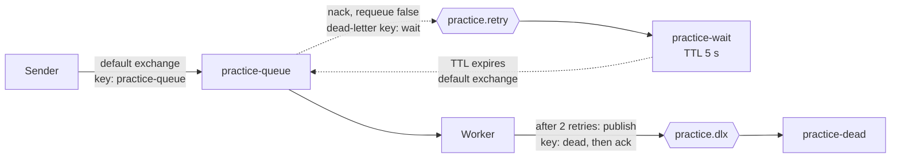

# RabbitMQ Practice Project

A hands-on practice project for learning message-based systems with RabbitMQ and .NET 10. It is not production code, and it is not a claim of production message-bus experience. The goal was to understand the moving parts (acknowledgements, durability, retries, dead-lettering) by building them and watching them fail.

Everything runs locally: RabbitMQ in Docker Compose, plus a console Sender, a Worker Service, and a small shared library. They use the official `RabbitMQ.Client` library directly (no MassTransit or other framework), so the concepts stay visible.

## What it does

A **Sender** publishes a text message to a durable queue. A **Worker** consumes it with manual acknowledgements and a prefetch of 1. "Processing" is simulated: it takes one second, and any message containing the word `poison` (case-insensitive) is treated as a failure.

A failed message is not retried immediately. It goes to a wait queue, sits there for 5 seconds, and returns to the work queue. After 2 retries it is moved to a dead-letter queue so it can be inspected.

## Architecture



| Name | Kind | Settings | Role |
|---|---|---|---|
| `practice-queue` | Queue, classic, durable | Dead-letters to `practice.retry` with key `wait` | Work queue |
| `practice.retry` | Exchange, direct, durable | Binding `wait` to `practice-wait` | Receives rejected messages |
| `practice-wait` | Queue, classic, durable | TTL 5000 ms, dead-letters to the default exchange with key `practice-queue` | Delay before a retry |
| `practice.dlx` | Exchange, direct, durable | Binding `dead` to `practice-dead` | Entry point to the parking lot |
| `practice-dead` | Queue, classic, durable | No dead-letter arguments | Holds messages that exhausted their retries |

The Worker declares this whole topology on startup. The Sender declares only the work queue. Both call the same declaration code in the Messaging project, so the queue arguments are written once.

### Message flow

1. The Sender publishes a persistent message to the default exchange, using the queue name as the routing key.
2. The Worker gets it (prefetch 1), waits one second to simulate work, and decides the outcome.
3. **Success:** acknowledge.
4. **Failure with retries left:** reject without requeue. The work queue's dead-letter settings send the message to `practice.retry`, then to `practice-wait`. After 5 seconds it expires back into the work queue. Each trip adds an `x-death` entry whose `count` increases.
5. **Failure with the retry limit reached:** the Worker publishes the message (with its original headers, marked persistent) to `practice.dlx` with key `dead`, then acknowledges the original.
6. **Shutdown (Ctrl+C):** the Worker cancels its consumer so no new messages arrive, then waits up to 15 seconds for a message already in progress to finish and be acknowledged, then closes the channel and the connection. A message that reaches the handler after shutdown began is left unacknowledged, and the broker redelivers it once the channel closes. That last path was never triggered in testing (see Known limitations).

The retry limit is `maxRetries = 2`, and the message is parked when the death count reaches it. A permanently failing message is therefore delivered 3 times in total: the first attempt plus 2 retries. One cycle takes roughly 6 seconds (1 second of simulated work plus the 5 second TTL).

## Prerequisites

- Docker Desktop
- .NET 10 SDK

Versions used while building this: RabbitMQ 4.3.6 (the floating `rabbitmq:4-management` tag resolved to this), `RabbitMQ.Client` 7.2.2, `Microsoft.Extensions.Hosting` 10.0.13, xunit.v3 4.0.1.

## How to run

```bash
docker compose up -d
```

Starts RabbitMQ with the management UI at http://localhost:15672 (user `admin`, password `password`). These are throwaway local credentials. Ports are bound to `127.0.0.1` only, and the container is capped at 2 CPUs and 2 GB of memory.

Next, give the apps the same credentials. The broker host (`localhost`) is in each app's `appsettings.json`. The user name and password are .NET user secrets, which are stored outside the repository and are loaded only in the Development environment. Both apps' launch profiles set Development, so `dotnet run` picks them up. Both projects share one user secrets ID, so you set the values once:

```bash
dotnet user-secrets set "RabbitMQ:UserName" "admin" --project src/RabbitMqPractice.Worker
dotnet user-secrets set "RabbitMQ:Password" "password" --project src/RabbitMqPractice.Worker
```

The values must match `RABBITMQ_DEFAULT_USER` and `RABBITMQ_DEFAULT_PASS` in `compose.yaml`. No `user-secrets init` is needed, because the secrets ID is already in the project files. If a value is missing, the connection code throws an `InvalidOperationException` such as `UserName is not configured`.

In one terminal, start the Worker. It declares all exchanges and queues:

```bash
dotnet run --project src/RabbitMqPractice.Worker
```

Press Ctrl+C to stop it. Step 6 of the message flow describes what happens to a message in progress.

In another terminal, send messages. The text comes from the command line, and defaults to `ticket A` when omitted:

```bash
dotnet run --project src/RabbitMqPractice.Sender -- ticket A
dotnet run --project src/RabbitMqPractice.Sender -- poison B
```

`ticket A` is processed and acknowledged. `poison B` fails, retries twice, and ends up in `practice-dead`, which you can confirm in the management UI.

Stop everything and wipe all broker state, including the data volume:

```bash
docker compose down -v
```

Plain `docker compose down` keeps the volume, so durable queues and persistent messages survive.

### Troubleshooting

- On one Windows machine, `docker compose up` failed with an error about `docker-credential-desktop` not being found. Running the same command from the Docker Desktop terminal worked. I did not diagnose the cause.
- `UserName is not configured` (or the same message for another setting) means that setting was not found. The user secrets may not be set, or the app may not be running in the Development environment. For example, `dotnet run --no-launch-profile` skips the launch profile, so the secrets are not loaded.

## What is tested

### Automated (17 xUnit v3 test cases)

`dotnet test` from the repo root runs them. They cover the pure decision logic, which lives in `RetryPolicy`:

- `Decide`: success always acknowledges, failures retry below the limit and park at or above it, including the boundary and a limit of 0.
- `GetDeathCount`: returns 0 for null headers or headers without `x-death`; reads the first entry's count (integer and long); throws `InvalidOperationException` for an empty array, a wrong-typed `x-death`, a non-dictionary entry, a missing `count`, a non-numeric count, and a null count.

I also checked that the tests can fail by temporarily introducing three bugs (`>=` changed to `>`, a wrong-typed header returning 0, and a null-unsafe count parse). Each was caught by exactly the tests expected.

### Verified by hand against a real broker

Nothing automated talks to RabbitMQ. These behaviors were observed manually. Rows marked (v1.0.0) were checked on the original console version, before the Worker Service host, and were not repeated. Some shutdown checks used a temporary longer simulated delay (10 or 30 seconds) so the shutdown window was easy to hit.

| Behavior | How it was checked |
|---|---|
| A message is removed only when acknowledged | Fetched messages in the management UI with different ack modes; stopped a consumer mid-message and watched the broker redeliver it (v1.0.0) |
| Durable queue plus persistent message survives a broker restart; a non-persistent message does not | `docker compose restart` with each kind of message (v1.0.0) |
| Data survives `down` but not `down -v` | Created a durable queue, then compared the broker's startup logs after each command (v1.0.0) |
| Prefetch of 1 stops one worker holding a batch of messages | Compared queue counts with and without it; ran two consumers against one queue (v1.0.0) |
| Retry with delay, retry cap, and dead-lettering | Ran `poison` messages end to end |
| The full topology comes up from code alone | Wiped the broker with `docker compose down -v`, started the Worker, and repeated the poison test |
| Starting the Sender first or the Worker first gives the same broker state | Wiped the broker, ran each order, and compared `rabbitmqctl list_queues name durable arguments messages` with a saved baseline. The output was identical both times. |
| A message in progress at Ctrl+C is finished and acknowledged | With a 10 second simulated delay, pressed Ctrl+C mid-message. The message was acknowledged and the queue was empty afterward. |
| No new message is started after Ctrl+C | Queued two messages and pressed Ctrl+C during the first. The second stayed in the queue and was processed on the next start. |
| A handler that outlives the 15 second wait loses its acknowledgement | With a 30 second simulated delay, the Worker warned after about 15 seconds. The acknowledgement failed with `AlreadyClosedException`, which was logged, and the message returned to the queue. Shutdown took about 29 seconds. |
| The Worker loads user secrets through the default host | Ran it with `dotnet run`. It reported the Development environment and connected, with the user name and password coming only from user secrets. |
| A missing setting is reported by name | Ran the Sender with `dotnet run --no-launch-profile`, so no secrets were loaded. It threw `InvalidOperationException: UserName is not configured`. |
| Topic exchange routing | **UI exercise only.** Built an exchange with three wildcard bindings in the management UI and published to it by hand. It is not part of this repo's code. |

## Design decisions

- **Default exchange for the Sender.** Publishing straight to the queue name keeps the first version simple. A named exchange would be the next step for several independent consumers.
- **Acknowledge after the work, not before.** A crash before the ack returns the message to the queue; acking first would lose it.
- **Prefetch of 1.** Safe and easy to reason about, but not fast. A real system would use a higher value.
- **Classic queues.** Chosen to match the queue already in the broker while debugging. Quorum queues (used by the current official tutorials) were not evaluated.
- **Decision logic is separate from I/O.** `RetryPolicy` is a pair of pure functions, so it can be unit tested without a broker. It stays in the Worker project because only the consumer retries.
- **A malformed `x-death` header throws instead of returning 0.** Returning 0 would make a message with an unexpected header retry forever and never reach the cap.
- **Topology is declared once, in a shared project.** `RabbitMqPractice.Messaging` holds the exchange, queue, and routing key names and the declaration code. Both apps call it, so each queue's arguments exist in one place (two copies that disagree would fail with `PRECONDITION_FAILED`). The Sender calls only the work-queue declaration, so starting it before the Worker still works.
- **The Worker is a Worker Service that owns its connection and channel.** They are not registered in dependency injection. I did not verify the client's rules for sharing a channel across threads, so I kept the connection and channel in one place. Only the small class that builds the connection settings is registered.
- **Shutdown drains the message in progress.** A semaphore is held while the handler runs. On stop, the Worker cancels the consumer first, then waits (up to 15 seconds) to take the semaphore, then closes the channel and the connection. Each cleanup step is guarded separately with its own time budget, so one failure does not skip the rest. Draining fits because the simulated work takes about one second. For long-running handlers, abandoning the message and accepting a redelivery would be the better trade.
- **A missing setting is an error, not an empty default.** The host name is in `appsettings.json`. The user name and password are user secrets (Development only). The connection code throws if a value is missing, so the error names the setting.

## Known limitations

- **The `x-death` ordering is assumed.** The code reads the first entry. On RabbitMQ 4.3.6, a retried message carries two entries: the wait queue's `expired` entry first, then the work queue's `rejected` entry, each with the same count. This was confirmed by decoding the header in the debugger. The code would need revisiting if the topology changed.
- **Publish-then-acknowledge is not atomic.** If the Worker crashes between publishing to the dead-letter exchange and acknowledging, the message is redelivered and parked twice. Publisher confirms would narrow the gap and were not used.
- **Exception behavior is only partly tested.** Observed: an acknowledgement on an already-closed channel throws `AlreadyClosedException`, which the handler logs and rethrows. Not tested: what the client does with the message and the channel when a handler throws on an open channel (for example, on a malformed header).
- **The retry-limit boundary was a deliberate choice.** `maxRetries = 2` with `>=` means 2 retries. Using `>` would allow 3.
- **The image tag floats.** `rabbitmq:4-management` may resolve to a different version later. Pin an exact version for reproducible runs.
- **Credentials.** The apps read them from user secrets, which is a development-only mechanism, and no other source was tested. The broker's throwaway credentials are still committed in `compose.yaml` and this README, which is acceptable only because the broker listens on localhost.
- **Shutdown time follows the handler, not the time budgets.** In the one run with a 30 second handler, the connection close ran about 9 seconds against its 5 second budget, and the acknowledgement was lost. The message was redelivered. The host's own shutdown timeout was not tested.
- **The late-message guard was never triggered.** After Ctrl+C the consumer is cancelled first, and in testing no message reached the handler afterward. The branch that leaves such a message unacknowledged is unexercised.
- **Duplicate processing is possible.** A lost acknowledgement means a redelivery and a second run of the work; an early shutdown experiment processed the same message twice. There is no idempotent handler yet.
- **Launch location.** The Worker found `appsettings.json` under `dotnet run` and in the debugger. Launching the built executables directly from another folder was not tested.

## Gotchas I hit

1. **`PRECONDITION_FAILED` on `x-queue-type`.** The official tutorial declares a quorum queue, but the queue I had created in the UI was classic. A queue's arguments are part of its identity, so a mismatching declaration is refused instead of modifying the queue. Fix: match the existing queue, or delete and recreate it.
2. **A silently dropped message in the retry loop.** The wait queue's dead-letter exchange had been entered as two literal quote characters instead of an empty string. The management UI showed the same text for both, so the queue looked correct. The messages vanished when the TTL expired, because RabbitMQ drops dead-lettered messages without an error when the target exchange does not exist. I found it by reading the queue's raw arguments from the management HTTP API.
3. **A routing key mismatch.** The work queue dead-lettered with key `wait`, but the retry exchange was bound with `retry`. Caught while reviewing the topology, before any message was lost.
4. **Topology that only worked on my broker.** The dead-letter exchange and queue existed only because I had created them by hand. Declaring them in code and rerunning from a wiped broker fixed it.
5. **A hosted service that returned early.** My first Worker Service port started the consumer and then returned from `ExecuteAsync`, so the `using` blocks disposed the channel and the connection. The host kept running, but `rabbitmqctl list_consumers` showed no consumer and the messages stayed in the queue. Fix: keep `ExecuteAsync` waiting until the stopping token is cancelled.
6. **A success message that was not true.** The handler logged "succeeded" before it sent the acknowledgement. During shutdown the channel was already closed, the acknowledgement failed with `AlreadyClosedException`, the message returned to the queue, and the log still said it had succeeded. Fix: log after the acknowledgement returns, and log exceptions from the handler before rethrowing them.
7. **The same command found the config file in one place and not another.** The Sender found `appsettings.json` under the debugger but not under `dotnet run` from the repo root, because the host looks in the working directory, which differed. Fix: set the host's content root to the executable's folder.

## Not included

- An ASP.NET Core API (the Sender is still a console program)
- Publisher confirms
- An idempotent handler or duplicate-message detection
- Authentication on any API
- A Dockerfile for the apps
- Dependency injection for the connection and channel (the Worker owns them directly)
- MassTransit or any other messaging framework
- Integration tests against a real broker, including shutdown behavior
- Quorum queues, clustering, or multi-node behavior
- Topic exchange routing in code (explored only by hand in the management UI)

## Repository layout

```text
compose.yaml                              RabbitMQ with the management UI
global.json                               Selects the Microsoft.Testing.Platform test runner
src/RabbitMqPractice.Messaging/           Queue, exchange, and routing key names; topology declarations; connection settings from configuration
src/RabbitMqPractice.Sender/              Publishes a message from the command line
src/RabbitMqPractice.Worker/              Worker Service: consumer, shutdown handling, and RetryPolicy
tests/RabbitMqPractice.Worker.Tests/      xUnit v3 tests for RetryPolicy
```