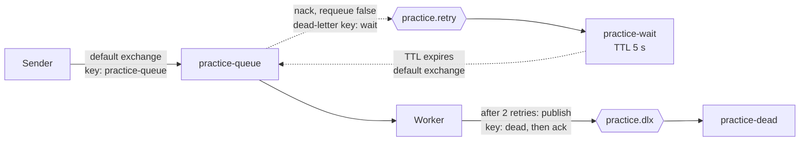
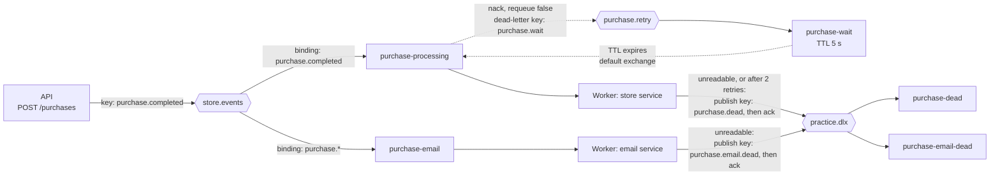

# Architecture

[README](../README.md) | [Architecture](architecture.md) | [How to run](running.md) | [Testing](testing.md) | [Design decisions](design-decisions.md) | [Known limitations](known-limitations.md) | [Gotchas](gotchas.md)

## The practice flow

| Name | Kind | Settings | Role |
|---|---|---|---|
| `practice-queue` | Queue, classic, durable | Dead-letters to `practice.retry` with key `wait` | Work queue |
| `practice.retry` | Exchange, direct, durable | Binding `wait` to `practice-wait` | Receives rejected messages |
| `practice-wait` | Queue, classic, durable | TTL 5000 ms, dead-letters to the default exchange with key `practice-queue` | Delay before a retry |
| `practice.dlx` | Exchange, direct, durable | Binding `dead` to `practice-dead`, binding `purchase.dead` to `purchase-dead`, and binding `purchase.email.dead` to `purchase-email-dead` | Entry point to the parking lots of all three consumers |
| `practice-dead` | Queue, classic, durable | No dead-letter arguments | Holds messages that exhausted their retries |

The Worker's practice service declares this whole topology on startup, through `PracticeTopology.DeclareAsync`. The Sender declares only the work queue, through `PracticeTopology.DeclareWorkQueueAsync`. Both use the same class in the Messaging project, so the queue arguments are written once.

## The store flow

| Name | Kind | Settings | Role |
|---|---|---|---|
| `store.events` | Exchange, topic, durable | Declared by the API and by each consumer | Entry point for purchase events |
| `purchase-processing` | Queue, classic, durable | Bound to `store.events` with key `purchase.completed`. Dead-letters to `purchase.retry` with key `purchase.wait`. Declared by the consumer. | The consumer's queue, named for its job |
| `purchase.retry` | Exchange, direct, durable | Binding `purchase.wait` to `purchase-wait` | Receives rejected purchase messages |
| `purchase-wait` | Queue, classic, durable | TTL 5000 ms, dead-letters to the default exchange with key `purchase-processing` | Delay before a retry |
| `purchase-dead` | Queue, classic, durable | Bound to `practice.dlx` with key `purchase.dead` | Holds purchase messages that could not be read, or that failed after 2 retries |
| `purchase-email` | Queue, classic, durable | Bound to `store.events` with key `purchase.*`. Declared by the email service. | The email service's queue, named for its job |
| `purchase-email-dead` | Queue, classic, durable | Bound to `practice.dlx` with key `purchase.email.dead` | Holds events the email service could not read |

The three dead-letter queues share one exchange but use different routing keys (`dead`, `purchase.dead`, and `purchase.email.dead`), so each consumer's parked messages land in its own queue.

The API declares only the exchange. Each consumer declares its own queue and binding. The result is that an event published before a consumer's queue has ever existed is never delivered to that consumer (see [Known limitations](known-limitations.md)).

## Message flow: the practice flow

1. The Sender publishes a persistent message to the default exchange, using the queue name as the routing key.
2. The Worker gets it (prefetch 1), decides the outcome, and waits one second to simulate work before acting on it.
3. **Success:** acknowledge.
4. **Failure with retries left:** reject without requeue. The work queue's dead-letter settings send the message to `practice.retry`, then to `practice-wait`. After 5 seconds it expires back into the work queue. Each trip adds an `x-death` entry whose `count` increases.
5. **Failure with the retry limit reached:** the Worker publishes the message (with its original headers, marked persistent) to `practice.dlx` with key `dead`, then acknowledges the original.
6. **Shutdown (Ctrl+C):** the host stops the three Worker services at the same time. Each one cancels its consumer so no new messages arrive, then waits up to 15 seconds for a message already in progress to finish and be acknowledged, then closes the channel and the connection. A message that reaches the handler after shutdown began is left unacknowledged, and the broker redelivers it once the channel closes. That last path was never triggered in testing (see [Known limitations](known-limitations.md)). The sequence is written once, in the base class that all three services share.

The retry limit is 2 (the practice and store services pass it to `RetryPolicy.Decide` as `2L`), and the message is parked when the death count reaches it. A permanently failing message is therefore delivered 3 times in total: the first attempt plus 2 retries. One cycle takes roughly 6 seconds (1 second of simulated work plus the 5 second TTL).

## Message flow: the store flow

1. A client sends `POST /purchases` with a quantity and a product name. The API validates the request: the quantity must be from 1 to 100, and the product name must be present and at most 100 characters. A request that fails validation gets a 400, and nothing is published.
2. The API builds a `PurchaseCompleted` event. It sets the message ID (a new GUID) and the timestamp (UTC) itself, so a client cannot choose them. It serializes the event to JSON and publishes it, persistent and with a JSON content type, to `store.events` with key `purchase.completed`. The response is 202 Accepted, with the event in the body.
3. The store service (prefetch 1) deserializes the body, prints the event ID, and asks `RetryPolicy` for the outcome. An event whose product name contains `poison` (case-insensitive) counts as a failure. The base class then waits one second to simulate work before acting on the outcome.
4. **Success:** acknowledge.
5. **Failure with retries left:** reject without requeue. The queue's dead-letter settings send the event to `purchase.retry`, then to `purchase-wait`. After 5 seconds it expires back into `purchase-processing`.
6. **Failure with the retry limit reached:** the service publishes the original body (with its headers, marked persistent) to `practice.dlx` with key `purchase.dead`, then acknowledges the original. That is 3 deliveries in total, as in the practice flow.
7. **Unreadable message:** if reading the message throws (invalid JSON, a missing required field, or a malformed `x-death` header), it is parked the same way at once, with no retry, because retrying cannot fix it.
8. **The email service** reads its own copy of the same event from `purchase-email`, prints the event ID, and, after the same simulated wait, acknowledges it. It never retries. If it cannot read the body, it publishes the original to `practice.dlx` with key `purchase.email.dead` and then acknowledges the original.
9. **The two consumers are independent.** A product name containing `poison` is a failure for the store service and an ordinary success for the email service.

## How a Worker service is structured

All three Worker services derive from `ConsumerServiceBase` (in `Worker/Common`). The base class owns everything the services have in common: the connection and channel, the topology declaration, a prefetch of 1, the semaphore that lets a message in progress finish, the late-message guard, acting on the outcome, the simulated delay, and the shutdown sequence.

A service supplies only what differs:

| Member | What it is |
|---|---|
| `ServiceName` | The connection name and the log tag: `practice`, `store`, or `email` |
| `ConsumeQueue` | The queue to read |
| `ParkRoutingKey` | The key used to park a message in the dead-letter exchange |
| `WaitingMessage` | The line logged when the service starts |
| `SupportsRetry` | False by default. The practice and store services set it to true. |
| `HandleAsync` | Reads one message and returns a `ConsumerResult`: an outcome (acknowledge, retry, or park) and a label for the log |

A hook never acknowledges anything. The base class acts on the outcome it returns. Every Worker line is logged as `[store   ] [INFO ] ...`, with the service name padded to 8 characters and the level to 5.
